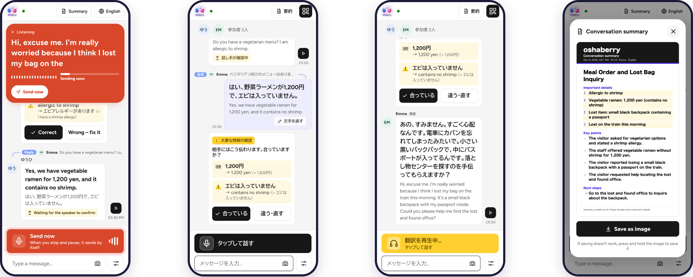
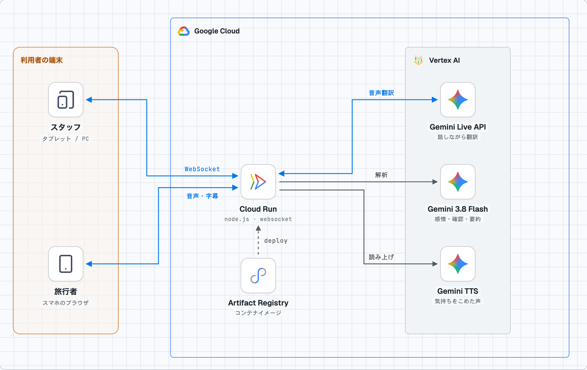

# oshaberry（おしゃべりー）

**言葉の通じない人どうしが、それぞれ自分のスマートフォンで、自分の言語のまま話せるリアルタイム翻訳アプリ**です。
お店・宿・駅のスタッフがタブレットで会話の部屋を作り、旅行者は QR コードを読むだけでブラウザから参加できます（インストール・ログイン不要）。

- **デプロイ URL**：https://oshaberry-1073341200378.asia-northeast1.run.app
- チーム：media ラブ/ DevFest GDGoC Japan Hackathon 2026（Tokyo 会場・観光カテゴリ）

> スタッフとして会話を始めるにはスタッフ用パスコードが必要です。旅行者側はアカウント不要です。



## できること

| 機能 | 内容 |
|---|---|
| QR で参加 | スタッフ画面の QR を読むだけ。スマホの設定から言語を推測し、入室時に「この言語で合っていますか？」と確認 |
| 話している途中から翻訳 | Gemini Live API の音声翻訳を中継し、話し終わる前から相手の画面に字幕が出る。最大 6 人が、それぞれの言語で同時に会話 |
| 押して話す | ボタンを押すとマイクが開き、話し終わると自動で送信。「準備中 → どうぞ → 聞き取り中 → まもなく送信」を大きく表示 |
| 気持ちをこめた声 | 声から感情と話し方を推定し、話し手に近い声で翻訳を読み上げ（選択式） |
| 大事なことだけ確認 | 金額・アレルギー・薬・安全に関わる内容だけ、逆翻訳を話し手に見せて確認。それ以外は会話を止めない |
| 単語帳（固有名詞） | スタッフが店名・メニュー・近くの駅を登録すると、書き起こし直しと翻訳でその名前を正しく扱う |
| 会話の流れ | 返信や訂正がどの発言に対するものかを判定し、チャット上で線でつなぐ |
| 文字・写真 | 文字入力、メニューや看板の写真（撮影・アルバムから）の説明 |
| 要約を持ち帰る | それぞれが自分の言語で、会話の要約を画像として保存 |
| 失敗しても止まらない | 翻訳できなかった発言は「翻訳できませんでした」と表示し、もう一度ボタンで再試行 |

## しくみ



- **サーバー中継**：ブラウザの 16 kHz 音声を WebSocket で Cloud Run に送り、サーバーが「話し手 × 聞き手の言語」ごとに Gemini Live API のセッションを開いて、字幕と翻訳音声を配ります。認証情報はブラウザに一切渡りません。
- **Vertex AI（サービスアカウント認証）**：API キーは使っていません。Cloud Run に割り当てたサービスアカウントで Vertex AI を呼び出します。
  - `gemini-3.5-live-translate-preview`（Live API）：音声のまま翻訳。原文字幕・翻訳字幕・翻訳音声を受け取る
  - `gemini-3.8-flash`：話し終わった発言の書き起こし直し（話し始め・固有名詞の補正）、文字の翻訳、感情と話し方の推定、重要情報の逆翻訳チェック、返信関係の判定、写真の説明、要約
  - `gemini-3.8-flash-tts` / `gemini-3.8-flash-lite-tts`：感情と話し方を指定した読み上げ（ストリーミング）
- **待ち時間を減らす工夫**：Live API のセッションを話し手 × 言語ごとに温めておき、最初の発話の遅れを避けます。音声は実時間のペースで送り、字幕・翻訳・読み上げを並行して進めます。
- **マイクの自動送信**：端末内の音声検出（AudioWorklet）で「話し終わった」を判断します。直近の静かな瞬間から周りの騒音の大きさを推定し、単発の物音は無視し、1 回の発話は最長 30 秒で区切るので、駅やカフェでも止まらなくなりません。
- **データの扱い**：会話はサーバーのメモリにだけ置き、会話終了時に削除します。音声は保存しません。

## 使用技術

- フロントエンド：Vue 3、TypeScript、Vite、Web Audio API（AudioWorklet）、PWA
- バックエンド：Node.js、Express 5、ws（WebSocket）、tsx
- Google Cloud：Cloud Run（asia-northeast1）、Vertex AI（Gemini Live API / Gemini 3.8 Flash / Gemini TTS）、Artifact Registry
- デザイン：BIZ UDPゴシック、Figtree、Meta の Astryx デザインシステムの考え方（色・角丸・高さのルール）

## ローカルで動かす

必要なもの：Node.js 24 以上、Vertex AI を有効にした Google Cloud プロジェクト、`gcloud` CLI。

```bash
gcloud auth application-default login   # Vertex AI はアプリケーションのデフォルト認証情報を使う
cp .env.example .env                    # GOOGLE_CLOUD_PROJECT を自分のプロジェクトに書き換える
npm install
npm run dev                             # API :8787 と画面 :5180 が起動
```

http://localhost:5180 を開き、スタッフ名と言語を入れて「新しい会話をはじめる」を押します。表示された招待 URL を別のブラウザ（またはシークレットウィンドウ）で開くと、2 人分の動作を確認できます。スマートフォンのマイクは HTTPS でしか使えないため、実機で試すときはデプロイ後の URL を使ってください。

### 環境変数（`.env`）

| 変数 | 内容 |
|---|---|
| `GOOGLE_CLOUD_PROJECT` / `GOOGLE_CLOUD_LOCATION` | Vertex AI を使うプロジェクトとロケーション（`global`） |
| `STAFF_PASSCODE` | スタッフが部屋を作るときのパスコード（空ならローカル開発用に誰でも作成可） |
| `LIVE_TRANSLATE_MODEL` ほか | 使うモデル名 |
| `LIVE_MINUTES_LIMIT` / `ANALYSIS_CALLS_LIMIT` / `TTS_CALLS_LIMIT` | アプリ側の使い過ぎ防止の上限 |

`.env` は `.gitignore` で除外しています。秘密情報はリポジトリに含めないでください。

## デプロイ（Cloud Run）

```bash
IMG=asia-northeast1-docker.pkg.dev/<PROJECT_ID>/<REPOSITORY>/oshaberry:v1
docker build --platform linux/amd64 -t $IMG . && docker push $IMG
gcloud run deploy oshaberry --image $IMG --region asia-northeast1 \
  --service-account <Vertex AI ユーザー権限を持つサービスアカウント> \
  --session-affinity --timeout 3600 \
  --set-env-vars GOOGLE_CLOUD_PROJECT=<PROJECT_ID>,GOOGLE_CLOUD_LOCATION=global,STAFF_PASSCODE=<任意のパスコード>
```

部屋の情報はメモリに置くため、WebSocket が同じインスタンスにつながるようセッションアフィニティを有効にしています。

## 費用とセキュリティ

- API キー・サービスアカウントの鍵ファイルは使っていません（Cloud Run のサービスアカウントで認証）。
- Google Cloud の費用上限（spend cap）に加えて、アプリ側でも Live 翻訳の分数・解析回数・読み上げ回数に上限を設けています（`server/guard.ts`）。`/api/health` で使用量の目安を確認できます。
- 同じ相手からの再翻訳などのリクエストには回数制限をかけています。

## テスト用スクリプト

Chrome の仮想マイク（WAV ファイル）を使い、実際の画面・音声検出・サーバー・Gemini を通して確認します。

| スクリプト | 内容 |
|---|---|
| `scripts/e2e.ts` | 文字と合成音声の一連の流れ |
| `scripts/stage-test.ts` | 押して話すの各段階（準備中 → 聞き取り中 → 送信）とスマホ表示 |
| `scripts/browser-test.ts` | スタッフ（日本語）と旅行者（英語）の 2 台で会話 |
| `scripts/feature-test.ts` | 重要情報の確認・写真・要約 |
| `scripts/latency.ts` | 字幕・翻訳・音声が届くまでの時間の計測 |
| `scripts/ui-shots.ts` | スマホ・タブレット・PC の画面撮影 |

例：`npm run dev` を起動したまま `npx tsx scripts/stage-test.ts`

## ディレクトリ構成

```
server/     Node.js サーバー（部屋の管理、Live API の中継、Gemini 呼び出し、使用量の上限）
src/        Vue 3 の画面（views/ 画面、components/ 部品、lib/ 音声・通信・多言語文言）
shared/     サーバーと画面で共有する型
public/     アイコン、ガイドのイラスト、資料用の画像
scripts/    動作確認・計測用スクリプト
design/     デザイン検討の資料（画面案、アーキテクチャ図の元データ）
```

## ライセンスとクレジット

- コード：[MIT License](LICENSE)
- フォント：BIZ UDPゴシック、Figtree（SIL Open Font License）
- アーキテクチャ図：[stack-diagram](https://github.com/caru-ini/stack-diagram)（MIT）で作成。Google Cloud 公式アイコン、[svgl](https://svgl.app) の Gemini ロゴ、[Lucide](https://lucide.dev) アイコン（ISC）を使用
- ガイドのイラストはチームの手描きです。そのほかの利用素材は提出物の「著作物利用シート」に記載しています。
